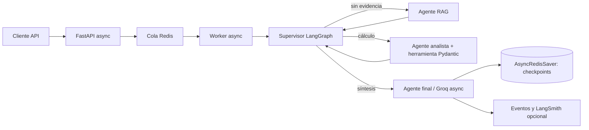

# IA-Entrega Final — The Intelligence System

Sistema de IA de grado de producción para consultas sobre conocimiento específico: combina RAG local, un supervisor LangGraph, agentes especializados, FastAPI asíncrona, Redis durable y observabilidad preparada para LangSmith.

## Arquitectura



El supervisor decide de forma reproducible: primero recupera evidencia, delega análisis si detecta una operación y luego sintetiza. Con `GROQ_API_KEY`, el nodo final llama asíncronamente a Groq; sin clave entrega una respuesta grounded de respaldo, útil para pruebas locales.

## Levantar con un comando

1. Opcional: copiá `.env.example` como `.env` y agregá `GROQ_API_KEY` si querés respuestas generadas por el modelo. Sin clave, el sistema ofrece el modo local grounded de respaldo.
2. Ejecutá:

```bash
docker compose up --build
```

La documentación interactiva queda en `http://localhost:8000/docs`.

Ejemplo:

```bash
curl -X POST http://localhost:8000/tasks -H "content-type: application/json" -d '{"question":"¿Cuál es el horario de préstamos?","thread_id":"demo-1"}'
```

Consultá el resultado con `GET /tasks/{job_id}`. Reutilizar el mismo `thread_id` conserva el checkpoint incluso si se reinicia la API, porque Redis usa persistencia AOF y `AsyncRedisSaver`.

## Configuración

| Variable | Uso |
|---|---|
| `GROQ_API_KEY` | Credencial de Groq, nunca se versiona. |
| `GROQ_MODEL` | Por defecto `openai/gpt-oss-120b`. |
| `REDIS_URL` | Cola de trabajos y checkpointer. |
| `LANGSMITH_TRACING`, `LANGSMITH_API_KEY`, `LANGSMITH_PROJECT` | Trazabilidad remota de LangSmith cuando hay credenciales. |

## Validación y trazabilidad

Ejecutá localmente:

```bash
python -m pip install -e ".[dev]"
pytest -q
```

Hay siete pruebas verificables: dos de validación Pydantic, dos de herramienta segura, una de RAG y dos de routing/trazas de nodos. Cada nodo agrega un evento estructurado con nombre, fecha y detalle; el resultado del trabajo devuelve esas trazas locales y el checkpoint las conserva. LangSmith queda configurado por entorno. No se afirma que existan trazas remotas: se requieren credenciales `LANGSMITH_API_KEY` y una ejecución del sistema para visualizarlas.
